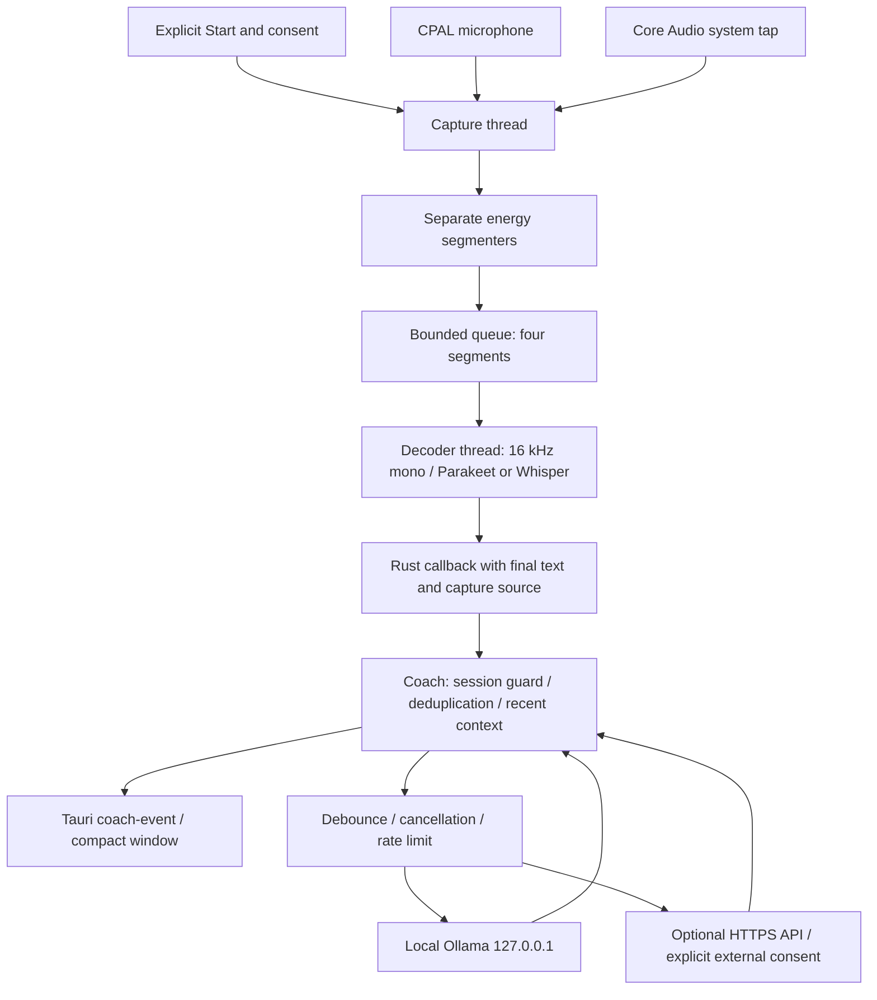

# Live Coach architecture

Live Coach is a separate Tauri 2 macOS application with bundle identifier
`com.dnalevity.livecoach`. Its frontend is the static HTML/CSS/JavaScript in `ui/`;
its privileged operations and conversation processing run in Rust. It does not
invoke Meetily, open Meetily's database, or call Meetily's recording commands.

## Upstream inspection and reuse boundary

Source inspected: [Meetily Community Edition](https://github.com/Zackriya-Solutions/meetily),
commit `a2cb62e827da7ef59f65064c97233efb2313878e`.
The freshly indexed `live-coach-upstream` graph was used for symbol discovery and
architecture orientation; source reads verified the actual interfaces. The
upstream audio scope contains 57 Rust files, with separate capture, stream,
recording-manager, processing, and transcription modules. Relevant source APIs:

| Upstream source | Actual API/behavior | Live Coach use |
| --- | --- | --- |
| `frontend/src-tauri/src/audio/capture/core_audio.rs` | `CoreAudioCapture::new()?.stream()?`; stream implements `Stream<Item = f32>`, exposes `sample_rate()` | Vendored direct Core Audio tap, avoiding recording and forwarding wrappers |
| `frontend/src-tauri/src/audio/stream.rs` | CPAL `build_input_stream`, sample conversion, `play`, `pause` and drop | Microphone stream adapted into `capture.rs` |
| `frontend/src-tauri/src/audio/audio_processing.rs` | `resample(&[f32], from_sample_rate, to_sample_rate) -> anyhow::Result<Vec<f32>>` | Vendored anti-aliasing sinc resampler |
| `frontend/src-tauri/src/parakeet_engine/model.rs` | `ParakeetModel::new(directory, quantized)` and `transcribe_samples(Vec<f32>) -> TimestampedResult` | Vendored local ONNX recognizer |
| `frontend/src-tauri/src/whisper_engine/whisper_engine.rs` | Whisper context, full inference parameters, final segment text extraction | Minimal decoder adapter; no engine/download manager |
| `frontend/src-tauri/src/audio/transcription/worker.rs` | `start_transcription_task(AppHandle, UnboundedReceiver<AudioChunk>) -> JoinHandle<()>` emits `transcript-update` | Inspected as reference; replaced with a bounded in-memory bridge and direct coach callback |

Upstream `TranscriptUpdate` contains `text`, `timestamp`, `source`, `sequence_id`,
`chunk_start_time`, `is_partial`, `confidence`, `audio_start_time`,
`audio_end_time`, and `duration`. Its source is set to `Audio`; this is not a
speaker identity. Live Coach labels its independent capture channels
`Microphone` and `System audio`. Neither implies reliable diarization.

Importing Meetily's recording manager would also import file savers, meeting
state, database, tray, analytics and summary behavior. Live Coach instead reuses
the low-level capture/recognition code without that persistence boundary.

## Runtime data flow

`capture::start(PathBuf, String, TranscriptCallback, StatusCallback).await` loads
an already installed recognizer before opening capture. The capture thread owns
both hardware streams. Microphone callbacks submit mono buffers through a bounded
channel; the Core Audio stream is polled directly. Each source has its own
20 ms energy frames, RMS threshold 0.006, 600 ms silence endpoint, minimum 500 ms
utterance, and maximum five-second segment. The separate decoder thread keeps
inference off the hardware polling path. Queue saturation reports dropped
segments instead of accumulating unbounded audio or blocking capture.

Final text goes directly into `Coach::ingest_for_session`, before frontend events.
A session token rejects stale results from earlier conversations. The coach
rejects repeated IDs, empty text, and immediately repeated matching text/source
within 2.5 seconds. Context is capped at 120 segments and approximately 24 KB.
Automatic coaching debounces 900 ms and enforces a 12-second minimum inference
interval. New text cancels pending or in-flight requests; request and session
numbers suppress stale responses. Quiet mode permits manual quick actions while
suppressing automatic coaching. The backend enforces participant acknowledgment
and external-processing consent.

Ollama uses `http://127.0.0.1:11434/api/chat` and is detected via `/api/tags`.
Optional OpenAI-compatible services use HTTPS `/chat/completions`, with no
redirect following or environment proxy routing. The API key is stored as the
macOS Keychain generic password service `com.dnalevity.livecoach`, account
`api-key`; it is never serialized into UI preferences.

## Models, privacy, and teardown

Discovery reads up to four directory levels under these Application Support
roots: `Meetily/models`, `com.meetily.ai/models`, and
`com.dnalevity.livecoach/models`. It does not create or alter shared model files.
Parakeet requires `vocab.txt`, `nemo128.onnx`, and encoder/decoder joint ONNX files
(regular or `.int8.onnx`). Whisper uses `ggml-*.bin`. File detection is only a
candidate check: actual decoder initialization catches incompatible formats.
There is no model downloader. The locally observed compatible-looking Parakeet
candidate is `com.meetily.ai/models/parakeet/parakeet-tdt-0.6b-v3-int8`.

Audio stays in bounded memory buffers; capture creates no recording file.
Transcript retention defaults off. On explicit opt-in, stopping writes the
bounded recent transcript to Live Coach's own Application Support transcript
folder (directory 0700, files 0600), with expiry clamped to 1–365 days. This is
recent context retention, not a guaranteed complete conversation archive.
Expiration runs on startup, while the app is running, and before history access.
Deletion clears current coach state and removes the app's transcript directory.
The app does not perform background deletion while it is closed.

Stop invalidates the coaching session, cancels inference/simulation, signals the
capture threads, pauses and drops the mic, drops the Core Audio tap, and joins
capture and decoder threads. An in-progress native decoder call may finish
before joining; its result is suppressed. Pending tail audio is deliberately
discarded. Closing the window follows the same teardown. Capture termination is
monitored and stops the session with an actionable error.

## Verification surfaces and limits

`capture::transcribe_fixture(&Path, engine, samples, sample_rate)` exercises the
same energy segmenter, sinc resampler and native decoder as live capture.
`CaptureHandle::activity()` exposes sample counts and peak amplitude for both
channels, allowing a hardware probe to distinguish stream creation from actual
sample flow. No waveform or transcript text is exposed by these counters.
Unit tests cover silence, silence endpoints, bounded overload, and anti-aliasing.
See the verification evidence and main README for observed results; a simulator
or fixture pass alone does not establish hardware capture success.

Core Audio taps require macOS 14.4 or later and appropriate audio permission.
Denied system permission may yield silence without an API error. Continuous
quiet speech can fail the energy threshold; five-second boundaries can divide
words; no echo cancellation or true speaker diarization is implemented. Use
headphones to reduce acoustic cross-capture. Capture sample rate is taken at
start, so restart after switching an output device or changing its sample rate.
Text alone cannot establish audible tone, interruption timing, or intent; the
coach prompt explicitly calibrates these claims and forbids diagnosis.

## Retained transcripts

Inference context remains bounded at 120 segments / 24 KB. A separate opt-in,
in-memory accumulator collects up to 10,000 finalized segments for the session;
only Stop or normal window closure writes it to the Live Coach transcript
folder. A crash loses unflushed retention. New retained files receive private
permissions and an expiry deadline. Expiry is enforced at startup, while running,
and on history access; no background process deletes files while the app is
closed. Delete now stops capture, cancels analysis, clears both buffers and retained
files, and disables retention for the current session.

## Startup model preparation (0.1.1)

The webview restores provider/model preferences and reads installed environment
before invoking `warm_ollama`. A separately owned `warmup::Warmup` uses only an
installed-model preflight and empty localhost generate request. It has no Coach,
CaptureHandle, consent, transcript, relationship context or Keychain reference.
Warm-up therefore cannot create a listening session. Its readiness text is separate
from recording status. UI generation IDs and backend watch/coalescing generations
prevent stale readiness when the selection changes; cancellation runs on provider
switch and app exit. Preload requests use a bounded response, 120-second timeout,
no proxy and no redirects. Missing/cloud-backed model names are rejected before
loading. Successful work is cached for ten minutes; timer/focus/model change renew
the 30-minute lease, shared by ordinary local chat requests.
